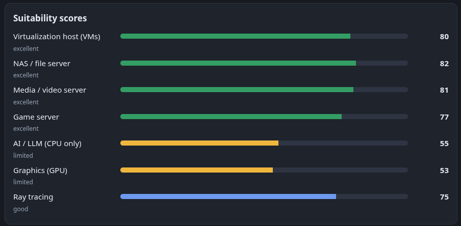
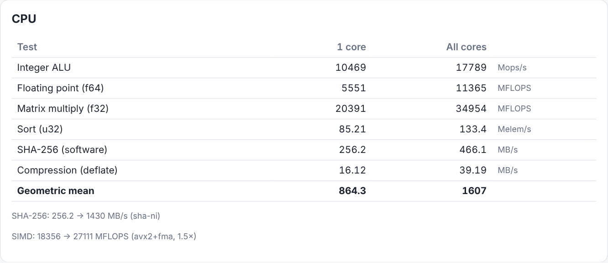
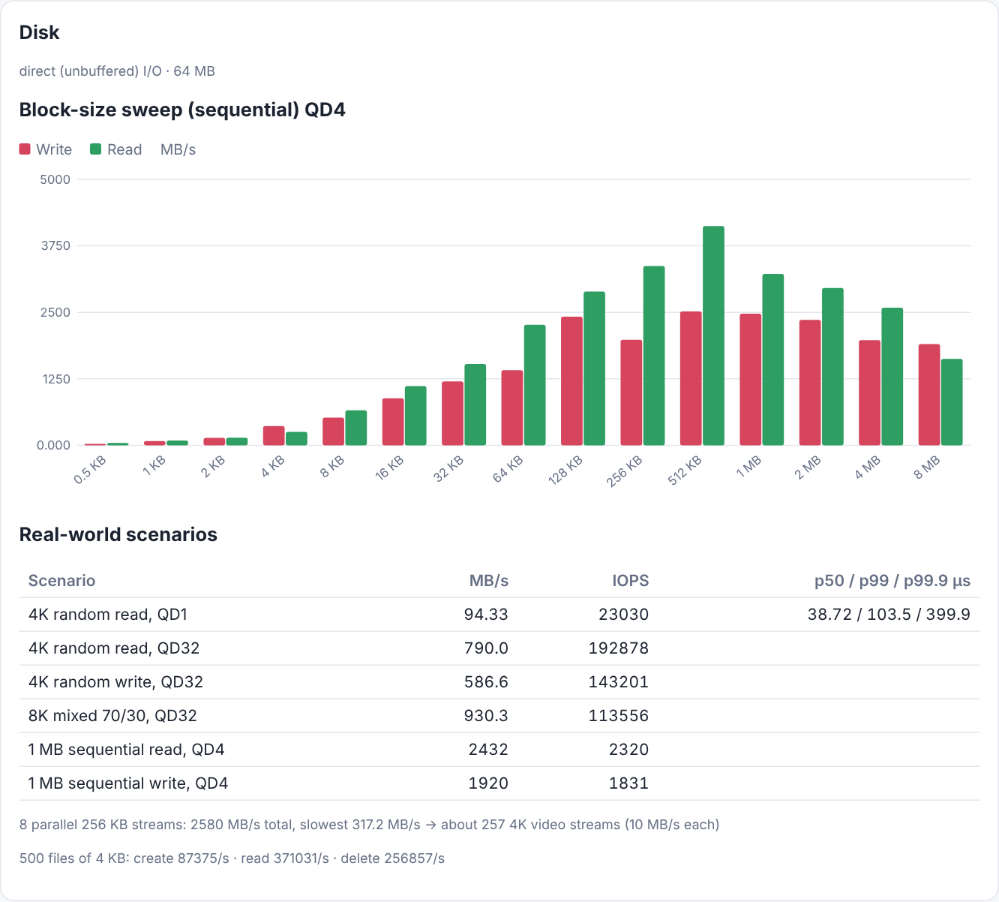
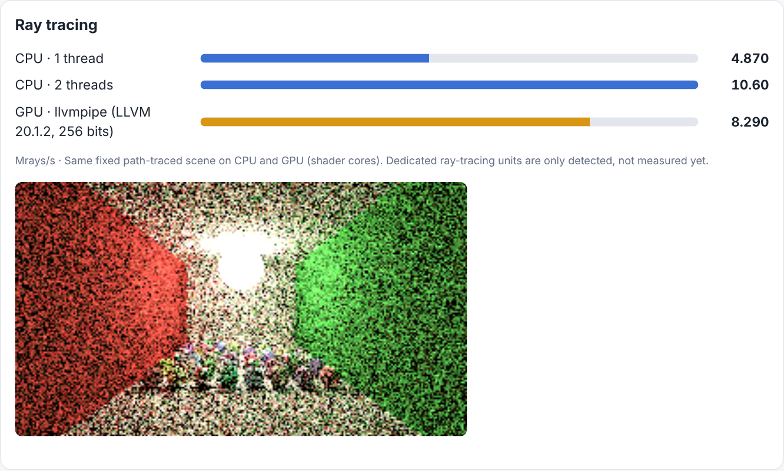
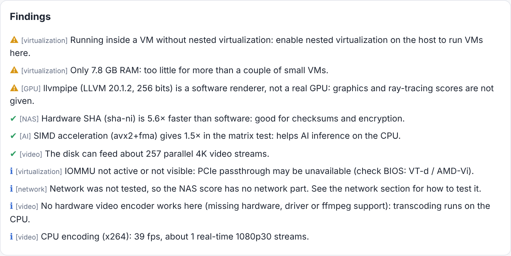

# 🪸 CORAL System Benchmark Utility


A single native program (written in Rust) that measures a machine and tells you **what it is good for**: a virtualization host, a NAS, a media / video server, a game server, local AI (LLM), graphics or ray tracing. Every test uses a fixed, deterministic workload, so results from different computers, phones and boards can be compared with each other later. Results are saved as JSON, text, HTML and CSV.

**⬇️ Download:** ready-made builds are on the [Releases page](https://github.com/OKTAYMERCAN/CORAL-System-Benchmark-Utility/releases).
**📚 Documentation:** see the [Wiki](https://github.com/OKTAYMERCAN/CORAL-System-Benchmark-Utility/wiki) (the pages live in the [`docs/`](docs) folder).

The program is called `syscheck` on the command line. It has no installer and no runtime: one binary, no Python, no pip, no browser.

## 🚀 Key Features

* ✅ **Suitability scores** — Virtualization host, NAS, Media / video server, Game server, AI / LLM, Graphics (GPU) and Ray tracing, each from 0 to 100 with a short verdict and plain-language findings ("no IOMMU: PCIe passthrough may not work").
* ✅ **CPU** — 6 fixed kernels (integer, f64, f32 matrix multiply, sort, SHA-256 in software, deflate), single core (pinned to the fastest core) and all cores. Hybrid / big.LITTLE CPUs are tested per core group. Hardware SHA versus software, AVX2 + FMA versus baseline.
* ✅ **Memory** — sequential read / write / copy / triad bandwidth, single thread and all threads, and a pointer-chasing latency curve from 4 KB to 256 MB that shows L1, L2, L3 and RAM.
* ✅ **Disk** — unbuffered I/O: block size sweep from 0.5 KB to 8 MB, several queue depths, 4K QD1 latency percentiles (p50 / p99 / p99.9), 4K QD32 IOPS, mixed 8K 70/30, 1 MB sequential, 8 parallel streams ("how many 4K video streams can it feed"), small files and an optional sustained write test.
* ✅ **Network** — TCP 1 / 4 streams up and down, both directions at once, RTT p50 / p99 / jitter, message size sweep. Runs between two real machines (`syscheck serve` and `syscheck net`). The result is limited by the weaker of the two devices.
* ✅ **Video encoding** — a fixed 1080p30 source encoded by the CPU (x264) and by every hardware encoder the machine offers (NVENC, QSV, VAAPI, AMF, VideoToolbox, MediaCodec): fps, 4-stream fps and how many real-time 1080p30 streams fit. Uses `ffmpeg` as a separate program.
* ✅ **Ray tracing** — a fixed path-traced scene (55 objects, 5 bounces) on the CPU, with the result checked against a reference checksum, and on the GPU with the same algorithm as a compute shader. Reported in Mrays/s.
* ✅ **GPU** — through Vulkan, Metal or DirectX 12: FP32 GFLOPS, integer Gops/s, memory bandwidth, matrix multiply (checked against the CPU), host to GPU copy speed and submit latency. Runs in a separate process, so a broken driver cannot take the report down. Software renderers are listed but never scored.
* ✅ **Comparable on purpose** — raw values are stored, scores are provisional and can be recomputed later. Every result carries a `spec` version; compare only results with the same one.
* ✅ **Merge everything** — `syscheck export` joins all saved JSON results into one CSV (67 columns), so a PC, a phone and a single-board computer end up in one table.
* ✅ **Private by design** — no host name, user name, IP address, MAC address or path is stored. Only the optional `--label` and `--notes` you type.
* ✅ **2 languages** — English (default) and Türkçe, chosen at start or with `--lang`. A saved result can be re-rendered in the other language later.

## 💻 Usage

[!NOTE] Always benchmark a **release** build. A debug build is 10 to 50 times slower, and the program warns about it.

**Build**

```
cargo build --release                          # target/release/syscheck, includes the GPU tests
cargo build --release --no-default-features    # without the GPU tests
cargo test --release
```

Android: build inside Termux (`pkg install rust`). Linux ARM64 / RISC-V boards: build on the board, or use `cross` (see `.github/workflows/build.yml`).
Optional: put `ffmpeg` in `PATH` for the video encoding test. Without it that test is skipped.

**Run**

```
syscheck                          # asks for the language, runs everything (a few minutes)
syscheck --lang tr --quick        # about 30 seconds
syscheck --label "Pixel 8" --csv all.csv
syscheck --path /mnt/nas --only disk --qd 1,4,32 --sustained 60
syscheck --only video,rt,gpu      # only encoding, ray tracing and GPU
```

**Real network test** (it is not part of the default run)

```
syscheck serve                    # on machine A (no authentication: trusted networks only)
syscheck net --server A_IP        # on machine B
```

**Saved results**

```
syscheck report result.json --lang tr --html report.html     # show a saved result again, in any language
syscheck export --dir syscheck-results --out all.csv          # merge all JSON results into one CSV
```

Results go to `./syscheck-results/` as `.json` (the complete record), `.txt` and `.html`.

Notes: if direct I/O is not available (tmpfs and similar), the disk test falls back to buffered I/O and says so in the report. On Windows, CPU pinning covers the first processor group (up to 64 logical CPUs). Ctrl-C during the disk test can leave a `.syscheck_<pid>.tmp` file in the test folder; delete it.

## 📸 Screenshots

*(Example report generated on a small cloud VM without a GPU, so the numbers are low and the GPU is a software renderer. Your hardware will look different.)*

(Suitability scores)


(CPU)


(Disk)


(Ray tracing)


(Findings)


## 🗺️ Planned Features

* 🔜 **Hardware ray tracing units** — they are detected today, but not measured yet. Shader-core ray tracing is measured.
* 🔜 **Windows details** — SSD / HDD detection, hybrid P / E core split, GPU memory size and network adapter details.
* 🔜 **Recalibrated scores** — the score ranges are provisional and will be tuned with results collected from many devices.
* 🔜 **Cleanup on Ctrl-C** — remove the disk test file automatically.

## 🐛 Known Issues

* **Only Linux x86-64 has been run by the author.** Windows (x86-64 and ARM64), macOS, Linux ARM64 / RISC-V and Android are written to build from the same source and are built by the CI workflow, but have not been tested on real hardware yet. Please open an issue if something breaks.
* **The GPU tests have only been run on a software renderer.** The compute shaders and the ray tracing shader are checked against the CPU, but real GPUs may show driver specific problems.
* **Scores are provisional.** Use the raw values for serious comparisons.
* **The network test is only as fast as the weakest part of the path:** the CPU of either device, the network card, the cable or the Wi-Fi.

## 📄 License

GPL-3.0, see the `LICENSE` file. The dependencies are open source crates with permissive licenses (MIT / Apache-2.0), which are compatible with GPL-3.0.

Copyright (C) 2026 Oktay Mercan https://github.com/OKTAYMERCAN/CORAL-System-Benchmark-Utility

---
AI used.
